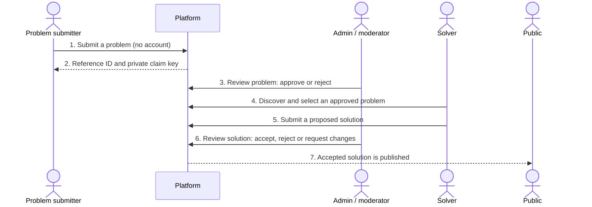
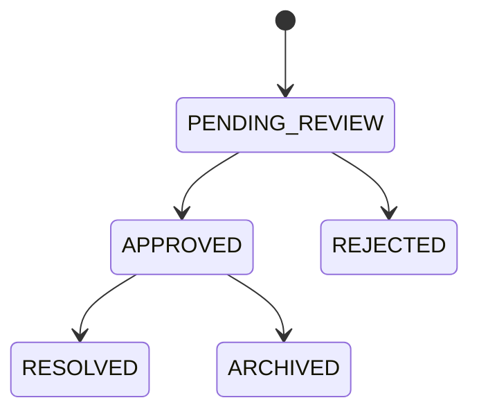
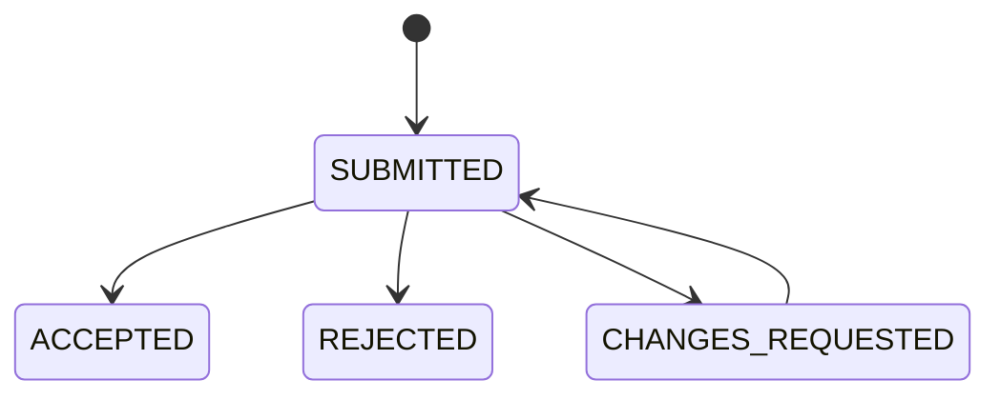

<a id="readme-top"></a>

<div align="center">


# SolveBridge

**Problems in · solutions out.**

An open innovation platform that connects people who face real-world problems with people who can build practical solutions — with a human moderator reviewing everything before it goes public.

<br />

[](LICENSE)
[](https://github.com/YOUR_USERNAME/YOUR_REPO/commits/main)
[](#contributing)
[](https://hits.sh/github.com/YOUR_USERNAME/YOUR_REPO/)


<br />

[**Live demo**](https://solvebridge.lovable.app) &nbsp;·&nbsp;
[How it works](#how-solvebridge-works) &nbsp;·&nbsp;
[Features](#features) &nbsp;·&nbsp;
[Security](#security-and-privacy) &nbsp;·&nbsp;
[Run locally](#run-locally) &nbsp;·&nbsp;
[Contributing](#contributing)

</div>

<br />

<p align="center">
  
</p>

---

## Overview

Anyone can submit a problem without creating an account. Registered solvers discover approved problems, choose the ones they want to work on and submit solutions. Before anything becomes public, a human moderator reviews it.

> **Nothing is published automatically.** Problems and solutions pass through two separate human review stages.

### At a glance

| | |
|---|---|
| 🧑‍🤝‍🧑 **3 roles** | Visitors and submitters (no account), solvers, admins |
| 🛡️ **2 review stages** | One for problems, one for solutions |
| 🔐 **Row Level Security** | Enabled on every application table |
| 🕵️ **Anonymous submissions** | Reference ID + one-time claim key, no sign-up needed |
| 📎 **Validated uploads** | Type, size, count and file-signature checks; private storage |
| ♿ **Accessibility-minded** | Skip link, labelled fields, live errors, reduced-motion support |

<details>
<summary><b>Table of contents</b></summary>

- [The vision](#the-vision)
- [The challenges we address](#the-challenges-we-address)
- [What kinds of problems belong on SolveBridge?](#what-kinds-of-problems-belong-on-solvebridge)
- [How SolveBridge works](#how-solvebridge-works)
- [Human review and publication](#human-review-and-publication)
- [Who uses SolveBridge?](#who-uses-solvebridge)
- [Features](#features)
- [Pages](#pages)
- [Technology stack](#technology-stack)
- [Project structure](#project-structure)
- [Database overview](#database-overview)
- [Security and privacy](#security-and-privacy)
- [Run locally](#run-locally)
- [Environment variables](#environment-variables)
- [Testing and CI](#testing-and-ci)
- [Accessibility](#accessibility)
- [Contributing](#contributing)
- [Security vulnerability reporting](#security-vulnerability-reporting)
- [Author](#author)
- [License](#license)

</details>

<!--
SCREENSHOTS: add real screenshots to docs/screenshots/ and uncomment this block.

## Screenshots

| Home | Problem directory |
|---|---|
|  |  |

| Submit a problem | Admin review |
|---|---|
|  |  |
-->

---

## The vision

Many useful ideas begin with a problem someone experiences in everyday life. However, the people who face those problems do not always know where to share them or how to reach people with the skills to help. At the same time, students, developers, researchers, designers, engineers, and other innovators may want to work on meaningful challenges but struggle to find problems worth solving.

SolveBridge aims to connect these two sides. The platform is built around a simple idea:

> **Every problem deserves a chance to be solved, and every capable mind deserves a problem worth solving.**

SolveBridge is not limited to software or technology challenges. It is intended to support practical problems from communities, education, agriculture, health, the environment, infrastructure, and other areas of everyday life.

The goal is to make real-world challenges easier to discover, invite independent approaches, and make reviewed solutions accessible to others who may benefit from them.

## The challenges we address

1. **Problems can remain unheard.** Individuals and communities may experience genuine problems but lack a straightforward way to present them to a wider problem-solving community.
2. **Innovators can struggle to find meaningful work.** Students and other aspiring problem-solvers may have skills and ideas but limited access to practical challenges.
3. **Potential solutions are difficult to compare.** A problem may have more than one possible approach. SolveBridge allows different solvers to work independently on the same approved problem.
4. **Problem owners and potential solvers are disconnected.** People who understand a problem firsthand and people with relevant skills may never find each other.
5. **Useful work can remain scattered.** Reviewed solutions can become publicly accessible references instead of remaining confined to an individual or small group.

SolveBridge provides a place to submit, discover, work on, review, and publish problem-solving contributions. It does not guarantee that every submitted problem will receive a solution or that every accepted proposal will solve the problem in every real-world context.

## What kinds of problems belong on SolveBridge?

SolveBridge is intended to be cross-sector. Example areas include:

| Category | Example challenges |
|---|---|
| 📚 Education & Learning | Access to learning resources, classroom challenges, affordable educational tools |
| 🌾 Agriculture | Irrigation, crop storage, resource wastage, practical farming challenges |
| 🌿 Environment | Waste management, pollution, conservation, sustainability |
| 🩺 Health & Well-being | Public hygiene, access to health information, community health resources |
| 🚌 Transportation | Local mobility, public transport accessibility, road-safety improvements |
| 💻 Technology | Digital accessibility, useful software or hardware tools, practical automation |
| 🤝 Social & Community Development | Accessibility, inclusion, local services, community needs |
| ⚡ Energy | Energy efficiency, renewable-energy access, resource management |
| 💧 Water & Sanitation | Water access, water conservation, sanitation challenges |

These are examples, not strict limits. A problem can be submitted under the most relevant available category, provided it is genuine, clearly described, and appropriate for the platform.

<p align="right"><a href="#readme-top">⬆ Back to top</a></p>

---

## How SolveBridge works



<details>
<summary><b>Step-by-step walkthrough</b></summary>

### 1. Submit a problem — no account required

Anyone can submit a problem through `/submit` without registering. The form includes:

- Problem title and description
- Category
- Optional location
- Optional private contact email
- Optional supporting images or PDF documents

After a successful submission, the server generates a human-friendly **Problem Reference ID** and a private, one-time **Claim Key**. The Reference ID identifies the submission. The Claim Key lets the submitter claim the problem later after creating an account. The Claim Key is displayed only once; only its protected hash is stored.

New submissions start in `PENDING_REVIEW` and are not visible in the public directory.

### 2. Admin reviews the problem

An admin or moderator checks the submitted problem before publication and can approve or reject it. An approved problem becomes visible in the public directory. Rejected, pending, and archived problems remain unavailable to public visitors.

### 3. Solvers discover and select problems

Registered users can browse approved problems, search by keyword, and filter by category. A solver can select a problem to work on and withdraw that selection later. Multiple solvers can select the same problem; selecting does not reserve or lock it. The public problem page shows the number of active selections, not a list of solver identities.

### 4. Solvers submit solutions

A solver can submit a proposed solution for a selected problem. A solution can include:

- Title and description
- Solution type: software, hardware, research, design, process, or other
- Optional GitHub repository link and live demo link
- Optional supporting attachments

The current workflow allows one active solution per solver per problem. If an admin requests changes, the solver can edit and resubmit. Different solvers can submit separate solutions for the same problem.

### 5. Admin reviews each solution

Every submitted solution goes through human review. The admin can:

- **Accept** — approve the solution for public display.
- **Reject** — decline the submission and provide feedback.
- **Request changes** — ask the solver to revise the submission and provide feedback.

Rejected and revision-requested submissions are not displayed as accepted public solutions.

### 6. Accepted solutions become public

Only accepted solutions associated with published problems are shown publicly, including on `/solved` and the relevant problem detail page. A problem can have multiple accepted solutions. Accepting a solution does not automatically mark the problem as resolved; problem status is managed separately by an admin.

</details>

## Human review and publication

Human moderation is a central part of SolveBridge.

| Content | Before publication | Who reviews it? | What becomes public? |
|---|---|---|---|
| Problem | `PENDING_REVIEW` | Admin / moderator | Only approved problems |
| Solution | `SUBMITTED` | Admin / moderator | Only accepted solutions |

<table>
<tr>
<td width="50%" valign="top">

**Problem status lifecycle**



</td>
<td width="50%" valign="top">

**Solution status lifecycle**



</td>
</tr>
</table>

An approved problem can remain open while solvers work on it. Admins manage whether it is open, resolved, or archived. The allowed review transitions are defined once in [`src/lib/review-rules.ts`](src/lib/review-rules.ts) and shared by the server, UI, and tests.

### Claiming an anonymously submitted problem

A submitter can create an account later and go to **Dashboard → Claim**, then enter the Problem Reference ID and the private Claim Key to associate the problem with their account.

The Claim Key is single-use. It is an ownership credential for linking the submission to an account; it is not independent verification of a person's real-world identity.

## Who uses SolveBridge?

| Role | Account required? | Capabilities |
|---|:---:|---|
| 👀 **Visitor** | No | Browse approved problems, search and filter, read accepted solutions |
| 📝 **Problem submitter** | No | Submit a problem and receive a reference ID and private Claim Key |
| 🛠️ **Solver** | Yes | Select problems, submit solutions, respond to revision requests, track work, claim a previously submitted problem |
| 🛡️ **Admin** | Yes, with admin role | Review and publish problems and solutions, manage categories and user roles, inspect the audit log |

<p align="right"><a href="#readme-top">⬆ Back to top</a></p>

---

## Features

<table>
<tr>
<td width="33%" valign="top">

### 🌍 Public experience

- Directory of approved problems
- Keyword search and category filtering
- Problem detail pages
- Public list of accepted solutions
- Anonymous problem submission
- Reference ID and one-time Claim Key

</td>
<td width="33%" valign="top">

### 🛠️ Solver experience

- Registration and sign-in
- Select and withdraw from problems
- Solutions with optional links and attachments
- Edit and resubmit when changes are requested
- Dashboard for selected problems, claimed problems, and solutions
- Claim a problem with its reference ID and Claim Key

</td>
<td width="33%" valign="top">

### 🛡️ Admin experience

- Review queue for problems
- Approve or reject problems
- Review queue for solutions
- Accept, reject, or request changes
- Manage categories and user roles
- Administrative audit history

</td>
</tr>
</table>

## Pages

<details>
<summary><b>Public pages</b></summary>

| Route | Purpose |
|---|---|
| `/` | Home page and platform introduction |
| `/problems` | Approved problem directory with search and category filters |
| `/problems/:referenceId` | Problem details and accepted solutions |
| `/solved` | Publicly accepted solutions |
| `/submit` | Anonymous problem submission |
| `/auth` | Sign up and sign in |
| `/forgot-password` | Password recovery |
| `/reset-password` | Password reset |

</details>

<details>
<summary><b>Signed-in solver pages</b></summary>

| Route | Purpose |
|---|---|
| `/dashboard` | Solver dashboard |
| `/dashboard/solve/:referenceId` | Submit a solution for a selected problem |
| `/dashboard/solutions` | List and manage submitted solutions |
| `/dashboard/solutions/:id` | View or edit a solution |
| `/dashboard/revisions` | Solutions that need changes |
| `/dashboard/problems` | Problems claimed by the user |
| `/dashboard/claim` | Claim an anonymous problem |
| `/dashboard/settings` | Profile settings |

</details>

<details>
<summary><b>Admin pages</b></summary>

| Route | Purpose |
|---|---|
| `/admin` | Admin overview |
| `/admin/problems` | Problem review queue and management |
| `/admin/problems/:id` | Problem review details |
| `/admin/solutions` | Solution review queue |
| `/admin/solutions/:id` | Solution review details |
| `/admin/categories` | Category management |
| `/admin/users` | User and role management |
| `/admin/audit` | Administrative review log |

</details>

## Technology stack

| Layer | Technology |
|---|---|
| Application framework | TanStack Start |
| UI | React 19 |
| Routing | TanStack Router |
| Data fetching and caching | TanStack Query |
| Language | TypeScript |
| Validation | Zod |
| Styling | Tailwind CSS v4 |
| UI components | shadcn/ui |
| Backend services | Lovable Cloud (Supabase) |
| Database | PostgreSQL |
| Authentication | Supabase Auth |
| File storage | Supabase Storage |
| Database access control | PostgreSQL Row Level Security (RLS) |
| Abuse prevention | Cloudflare Turnstile, honeypot field, rate limiting |
| Tests | Vitest |

Built with [Lovable](https://lovable.dev).

## Project structure

<details>
<summary><b>Show the repository layout</b></summary>

```text
.
├── src/
│   ├── routes/                 # file-based routes: public, auth, dashboard, admin
│   ├── components/             # ui/, site layout, forms and feature components
│   ├── lib/
│   │   ├── public.functions.ts     # server functions for visitors
│   │   ├── solver.functions.ts     # server functions for signed-in solvers
│   │   ├── admin.functions.ts      # admin server functions (authorization checked)
│   │   ├── server-utils.server.ts  # rate limiting, Turnstile, privileged access
│   │   ├── review-rules.ts         # shared moderation state transitions
│   │   ├── queries.ts              # TanStack Query options
│   │   ├── schemas.ts              # Zod validation schemas
│   │   ├── crypto.ts               # reference ID and Claim Key generation and hashing
│   │   └── files.ts                # upload validation
│   └── integrations/supabase/  # client integration and generated types
├── drizzle/migrations/         # database schema and SQL migrations
├── .github/workflows/ci.yml    # continuous integration
├── .env.example
├── SECURITY.md
├── LICENSE
└── package.json
```

The repository's actual files and package scripts are the source of truth. If the implementation changes, keep this section in sync with the code.

</details>

## Database overview

The application uses PostgreSQL through Supabase, with Row Level Security enabled on application tables.

| Table | Purpose |
|---|---|
| `profiles` | Public display name, avatar, bio |
| `user_roles` | Role assignments (`admin`, `solver`) |
| `problem_categories` | Problem categories |
| `problems` | Submitted problems and their status |
| `problem_claims` | Claim Key hashes (server access only) |
| `problem_selections` | Which solvers selected which problems |
| `solutions` | Submitted solutions and their status |
| `problem_media`, `solution_media` | Attachment records |
| `admin_reviews` | Administrative audit log |
| `rate_limits` | Abuse-prevention counters |

Accepted solutions remain linked to their original problem; they are not stored in a separate, disconnected solved-problems database.

<p align="right"><a href="#readme-top">⬆ Back to top</a></p>

---

## Security and privacy

Security is a core requirement because SolveBridge accepts anonymous submissions, user accounts, file uploads, and admin moderation actions.

| Control | What it does |
|---|---|
| 🗄️ **Database-level access control** | RLS on application tables. Public queries must not expose private contact emails, submitter user IDs, Claim Key hashes, or admin-only feedback. |
| ✅ **Moderated publication** | Pending, rejected, and archived problems are not public. Only accepted solutions attached to published problems are public. |
| 🔑 **Server-only credentials** | The Supabase service-role key and other private secrets stay on the server and never reach browser code. |
| 👮 **Server-side admin authorization** | Admin operations verify the caller on the server. Hiding an admin page in the UI is not protection. |
| 🧾 **Protected Claim Keys** | Generated securely, protected with a server secret and HMAC, stored as a hash, compared in constant time. |
| 📎 **Upload validation** | Allowed type, size, count, and file signature are checked. Files live in private buckets and are served through short-lived signed URLs. |
| 🤖 **Abuse prevention** | Cloudflare Turnstile in production, a honeypot field, and rate limits on the public submission form. |
| ✉️ **Account verification** | Email confirmation is required for sign-up. |
| 🛡️ **Controlled admin roles** | Users cannot grant themselves admin permissions through a profile form or client-side request. |

Never commit real credentials to Git. Keep local environment files out of version control and configure production secrets through the hosting provider's secret manager. To report a security issue, see [SECURITY.md](SECURITY.md).

## Run locally

### Prerequisites

- [Git](https://git-scm.com/)
- [Bun](https://bun.sh/) (the commands below use Bun)
- Access to a configured Supabase project / Lovable Cloud backend

Use the package manager and lockfile already present in the repository, and do not mix package managers in one working copy.

### Quick start

```bash
# 1. Clone
git clone https://github.com/diponkor-sinha/SolveBridge-hackathon.git
cd SolveBridge-hackathon

# 2. Install dependencies
bun install

# 3. Configure environment variables (never commit .env)
cp .env.example .env

# 4. Start the development server
bun run dev
```

### Configure Supabase

You need a Supabase project with:

- The migrations in `drizzle/migrations/` applied.
- **Private** Storage buckets named `problem-media` and `solution-media`, restricted to JPG, PNG, WEBP and PDF with a 5 MB limit.
- Email confirmation enabled in Supabase Auth.
- The required authentication and database policies configured.

To create the first admin, register a user, then grant that user's ID the `admin` role in `user_roles` through a trusted administrative process. Never expose admin role assignment to ordinary users.

### Available scripts

```bash
bun run dev      # start the development server
bun run build    # production build
bun run test     # run the Vitest suite
bun run lint     # lint the codebase
```

If a command is unavailable, check the `scripts` section of `package.json`.

## Environment variables

Use `.env.example` as the authoritative template for the current code.

| Variable | Purpose | Exposure |
|---|---|---|
| `SUPABASE_URL` | Supabase project URL | Public configuration |
| `SUPABASE_PUBLISHABLE_KEY` | Supabase publishable key | Public; access must still be protected by RLS |
| `SUPABASE_SERVICE_ROLE_KEY` | Privileged server-side Supabase access | **Server only — never expose to the browser** |
| `CLAIM_KEY_SECRET` | Server secret used to protect Claim Keys | **Server only** |
| `TURNSTILE_SITE_KEY` | Cloudflare Turnstile site key | Public configuration |
| `TURNSTILE_SECRET_KEY` | Cloudflare Turnstile verification secret | **Server only** |

Generate a strong Claim Key secret with `openssl rand -hex 32`.

<details>
<summary><b>Secret-handling rules</b></summary>

- Do not add `SUPABASE_SERVICE_ROLE_KEY`, `CLAIM_KEY_SECRET`, or `TURNSTILE_SECRET_KEY` to client-side code.
- Do not prefix private secrets with `VITE_`, `NEXT_PUBLIC_`, or any other client-exposure prefix.
- Do not print secrets in logs or return them from server functions.
- Do not commit `.env` or other files containing real credentials.
- If a secret is accidentally exposed, rotate it in the provider's dashboard immediately.
- Public/publishable keys are not substitutes for RLS policies.
- Turnstile verification must happen on the server; only the site key may be used by the browser widget.

</details>

<p align="right"><a href="#readme-top">⬆ Back to top</a></p>

---

## Testing and CI

```bash
bun run test
```

The project uses Vitest. Tests cover core moderation rules and security-related behavior, including credential and reference-ID generation, upload validation, form schemas, client-IP handling, Turnstile verification, security headers, and router caching and preloading.

GitHub Actions (`.github/workflows/ci.yml`) runs tests, lint, and build checks on pushes and pull requests. Before opening a pull request, run:

```bash
bun run test && bun run lint && bun run build
```

## Accessibility

- Skip-to-content link
- Labelled form fields
- `aria-describedby` and `aria-invalid` for form feedback
- Live error messages
- `prefers-reduced-motion` support
- Alternative text for images

Accessibility should be maintained when adding or changing UI components.

## Contributing

Contributions, suggestions, and thoughtful feedback are welcome.

1. Check existing issues and discussions, if enabled.
2. Keep changes focused and explain the problem they address.
3. Follow the existing project structure and coding conventions.
4. Run the relevant tests, lint checks, and production build.
5. Never include real API keys, passwords, tokens, or other secrets in a commit.

For substantial changes to moderation rules, database access, authentication, or file uploads, include tests that cover the expected behavior and the relevant failure cases.

## Security vulnerability reporting

Please do not publish sensitive vulnerability details in a public issue. Follow the private reporting instructions in [SECURITY.md](SECURITY.md).

## Author

**Diponkor Sinha** — [@DIPONKOR_SINHA](https://github.com/diponkor-sinha)

## License

Released under the [MIT License](LICENSE).

<br />

<div align="center">

**Every problem deserves a chance to be solved.**

Built with [Lovable](https://lovable.dev) · [⬆ Back to top](#readme-top)

</div>
